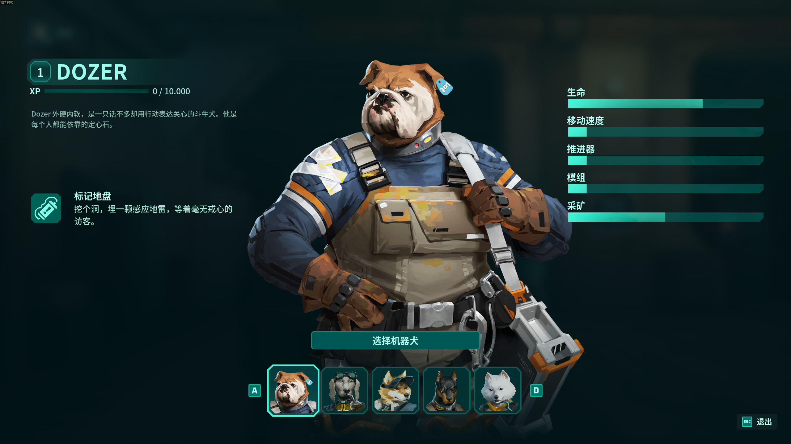

# GRAVHOUNDS 简体中文汉化补丁（非官方）

> **⚠️ 声明**：本项目为非官方玩家汉化，仅供个人学习交流使用，请支持正版。
> **如官方推出简体中文，或开发者提出任何要求，本仓库与 releases 将【立即下架】。**

> **🛡️ 防伪说明（请务必阅读）**
> 本补丁的**唯一发布渠道**为本仓库 Releases 及作者本人在 Steam 评测中给出的网盘链接。
> 除此之外任何转载、修改、打包、**收费售卖**的版本均与作者无关，请勿下载使用。
> 校验方法：下载后运行 `certutil -hashfile 文件名 SHA256`，与下方表格比对，**不一致即为第三方篡改版**。

游戏当前版本：**CL 29726**（2026-11-02 EA 首发） | 补丁版本：v1.3

## 下载

**GitHub 直下**（Releases 页点 zip）：
[GravHounds-zhCN-patch-v1.3.zip](../../releases/download/v1.0/GravHounds-zhCN-patch-v1.3.zip)

**国内加速直链**（内容与本页 Release 完全一致，SHA256 相同）：
https://ghfast.top/https://github.com/xbishi/GravHounds-Chinese-Patch/releases/download/v1.0/GravHounds-zhCN-patch-v1.3.zip

**网盘**（国内推荐，内容与 GitHub Release 完全一致）：
- 夸克网盘：https://pan.quark.cn/s/b25ac55fe83d （需夸克 App 打开）
- 百度网盘：https://pan.baidu.com/s/1D8Ppz73_bdHr-EuKOVPkUQ?pwd=am2c （提取码：am2c）

## 授权协议

本补丁（含全部汉化文本与脚本）以 [CC BY-NC-SA 4.0](LICENSE) 协议发布：**署名 · 非商业性使用 · 相同方式共享**。
任何人不得将其用于商业用途或收费分发；二次分享须保留本仓库署名与相同协议。游戏《GRAVHOUNDS》的一切权利归 Octopus Panic, Inc. 所有。

## 安装（三步）

1. 从 [Releases](../../releases) 下载 `GravHounds-zhCN-patch-v1.3.zip`，解压得到 `GravHounds中文补丁` 文件夹
2. 把这个文件夹**整个放进游戏根目录**（就是有 `WFOSteam.exe` 的那一层，和 `Engine`、`WFO` 并排）
3. 双击文件夹里的 **`安装中文.bat`**，等 1~2 分钟看到「★ 安装完成！」即可

### 装完必须做的一次性设置 ★★★

启动游戏 → **OPTIONS → GAMEPLAY → LANGUAGE** → 选 **Deutsch (German)** → 返回 → 弹窗点 OK（游戏自动重启）→ 重启后界面即为简体中文

> 原理说明：游戏语言列表硬编码 6 种且不含中文，本补丁将德语位的文本与字体整体替换为简体中文。

## 卸载

双击补丁文件夹里的 **`卸载还原.bat`**（自动还原原版 pak）。
或：Steam 库右键游戏 → 属性 → 已安装文件 → **验证文件完整性**，亦可还原。

## 注意事项

- ⚠️ **游戏更新后补丁会失效**：更新后请先运行 `卸载还原.bat` 还原，等本仓库出新版本再装
- ⚠️ **联机**：建议联机的所有玩家安装同一版本补丁，版本不一致可能无法连接或崩溃
- 🛡️ `repak.exe` 为开源工具（[Apache-2.0](https://github.com/trumank/repak)），未签名程序可能被杀软误报，介意者可自行扫描验证
- 字体：Noto Sans SC（[SIL OFL](https://fonts.google.com/noto/specimen/Noto+Sans+SC) 开源协议），已按游戏字符集子集化

## 文件校验

| 文件 | SHA256 |
|---|---|
| `GravHounds-zhCN-patch-v1.3.zip` | `9ee04c390c510041a601e910004b2a15d3e441db23af4223dc97f178a57a233e` |

## 源码审计

补丁的全部文件就在本仓库 `overlay/`、`tools/` 目录及根目录脚本中，与 Release 包内容完全一致，可自行比对审计——不含任何游戏原始资源，不含网络行为，脚本逻辑一目了然。

## 工作方式（技术说明）

补丁**不分发任何游戏原始资源**：安装脚本在你本机用 [repak](https://github.com/trumank/repak) 解包你自己的 `pakchunk0-Windows.pak`，注入中文 locres / locmeta / 字体后重新打包（v11 + Zlib），原包自动备份为 `pakchunk0-Windows.pak.orig`。

- 汉化文本：5716 条全部翻译（UI / 对话 / 成就 / 设置说明）
- 字体：Saira 全系（23 个 .ufont）替换为 Noto Sans SC 子集（2101 字符）
- 原生语言机制说明：UE 对原生文化（en）直接显示资产内烘焙字符串，故汉化绑定在非原生的 de 语言位上

## 更新日志

- **v1.3**（2026-11-07）：**适配 11-06 游戏更新内容**——新增存档系统 15 条文本汉化（覆盖存档/读取失败/继续不保存等弹窗）、3 条更名内容同步（Cutting Edge→尖端科技、Danger Close→贴身火力、Dead Drop→死信投放）；引擎键位包随新版刷新
- **v1.2**（2026-11-07）：**适配 11-06 游戏更新**——修复"游戏更新后重装补丁导致启动报 StreamlineDeepDVC 错误"的脚本缺陷：安装/卸载脚本增加备份过期守卫（.orig 早于游戏版本时自动拒绝使用旧备份）与注入痕迹嗅探（检测到版本不匹配时给出明确恢复指引）。注意：本次游戏更新新增的内容暂时显示英文，翻译更新见后续版本
- **v1.1**（2026-11-05）：修正误翻（Ping→标记、Train→训练）；**键位名改为英文键盘原名**（如 Space/Space Bar，不再随德语语言位显示 Leertaste 等德语键名）
- **v1.0**（2026-11-05）：首发，全量文本汉化 + 字体支持，对应游戏 CL 29726
